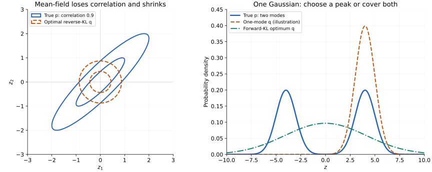

Generative modeling asks for more than a prediction. It asks us to learn enough of a data distribution to create new samples from it.

Two influential approaches appear very different:

- a variational autoencoder compresses data into a probabilistic latent space and decodes samples from it;
- a diffusion model destroys data with noise and learns how to reverse that destruction.

Their common language is probability: latent variables, approximate inference, Gaussian reparameterization, likelihood, and variational bounds.

This post collects the generative-model material from my original ML/AI mathematics study notes. The basic probability concepts are developed separately in [Probability and Statistical Inference for Machine Learning](/posts/probability-statistical-inference-for-machine-learning/).

## Topic map

- [Latent-variable models](#latent-variables)
- [Why exact posterior inference is hard](#intractable-posterior)
- [Variational inference and the ELBO](#variational-inference)
- [Variational autoencoders](#vae)
- [The reparameterization trick](#reparameterization)
- [DDPM forward diffusion](#forward-diffusion)
- [The closed-form noising equation](#closed-form)
- [Reverse diffusion and training](#reverse-diffusion)
- [How VAEs and diffusion models connect](#connection)

---

## 1. Latent-variable models {#latent-variables}

A latent variable is not directly observed but helps explain observed data. Let $x$ be an observation and $z$ a latent variable. A generative model describes their joint distribution as

$$
p_\theta(x,z)=p(z)p_\theta(x\mid z).
$$

The process reads from right to left:

1. sample a latent value $z$ from a prior $p(z)$;
2. generate $x$ from the conditional distribution $p_\theta(x\mid z)$.

For images, $z$ may encode factors such as pose, lighting, style, or object identity—even though the model is not explicitly told those names. For a mixture model, the latent variable might be a cluster assignment. In a hidden Markov model, it is an unobserved state sequence.

The likelihood of an observed example must marginalize the hidden variable:

$$
p_\theta(x)=\int p_\theta(x,z)\,dz
=\int p(z)p_\theta(x\mid z)\,dz.
$$

The integral is where the mathematical difficulty begins.

---

## 2. Why exact posterior inference is hard {#intractable-posterior}

After observing $x$, we would like the posterior distribution of its latent explanation:

$$
p_\theta(z\mid x)
=\frac{p_\theta(x,z)}{p_\theta(x)}
=\frac{p(z)p_\theta(x\mid z)}
{\int p(z)p_\theta(x\mid z)\,dz}.
$$

For a neural decoder, the evidence integral in the denominator is usually high-dimensional and has no useful closed form. “Intractable” does not mean logically impossible. It means exact evaluation is unavailable or computationally prohibitive at the required scale.

Sampling methods such as **Markov chain Monte Carlo (MCMC)** approximate the posterior with samples. Variational inference takes a different route: turn inference into optimization.

---

## 3. Variational inference: approximate a distribution by optimizing {#variational-inference}

Choose a tractable family $q_\phi(z\mid x)$ to approximate the true posterior $p_\theta(z\mid x)$. We would like to minimize

$$
D_{\mathrm{KL}}
\left(q_\phi(z\mid x)\|p_\theta(z\mid x)\right).
$$

Substitute Bayes' rule:

$$
\begin{aligned}
D_{\mathrm{KL}}(q_\phi\|p_\theta)
&=\mathbb E_{q_\phi}
\left[
\log q_\phi(z\mid x)
-\log p_\theta(x,z)
+\log p_\theta(x)
\right]\\
&=\log p_\theta(x)
-\mathbb E_{q_\phi}
\left[
\log p_\theta(x,z)-\log q_\phi(z\mid x)
\right].
\end{aligned}
$$

Define the evidence lower bound,

$$
\mathcal L(\theta,\phi;x)
=\mathbb E_{q_\phi(z\mid x)}
\left[
\log p_\theta(x,z)-\log q_\phi(z\mid x)
\right].
$$

Then

$$
\log p_\theta(x)
=\mathcal L(\theta,\phi;x)
+D_{\mathrm{KL}}
\left(q_\phi(z\mid x)\|p_\theta(z\mid x)\right).
$$

KL divergence is nonnegative, so

$$
\mathcal L(\theta,\phi;x)\le\log p_\theta(x).
$$

This is why it is a lower bound. Maximizing the ELBO simultaneously raises a lower bound on data likelihood and reduces the gap between the approximate and true posterior.

Variational inference is especially useful in three settings: limited data where informative priors matter, problems that require explicit uncertainty, and generative modeling with hidden variables.

### Choosing the variational family

VI asks us to choose both **which distributions are allowed** and **how to measure their mismatch** with the posterior. Even perfect optimization can give a poor approximation if these choices cannot preserve the features we care about.

#### 1. What is a variational family?

For a fixed observation $x$, we want $q_\phi(z\mid x)$ to approximate $p_\theta(z\mid x)$. The **variational family** is the set of distributions that $q_\phi$ can represent as we vary its parameters $\phi$.

For example, if we choose

$$
q_\phi(z\mid x)=\mathcal N(z;\mu_\phi(x),\sigma_\phi^2(x)),
$$

then optimization can move the mean and change the variance, but every candidate is still a single Gaussian bell curve. It cannot become a distribution with two separate peaks. Choosing the family is like choosing straight lines for curve fitting: optimizing the slope and intercept cannot turn a line into a circle.

Why not allow every possible distribution? We need a representation we can compute with: typically, we must be able to sample from $q_\phi$, evaluate its log-density, and estimate ELBO gradients efficiently. A very flexible family may make those operations expensive. A very simple one may miss important posterior structure.

<h4 id="2-what-does-the-mean-field-assumption-remove">2. What is the mean-field assumption?</h4>

The **mean-field assumption** means choosing an approximate posterior in which the latent coordinates are **independent of one another for a fixed observation $x$**. We represent the joint distribution as a product of separate distributions, one for each coordinate. This product form is called **factorization**.

For two latent coordinates, $z=(z_1,z_2)$, the assumption is

$$
q_\phi(z_1,z_2\mid x)
=q_{\phi_1}(z_1\mid x)q_{\phi_2}(z_2\mid x).
$$

For $d$ latent coordinates, this becomes

$$
q_\phi(z\mid x)=\prod_{j=1}^d q_{\phi_j}(z_j\mid x).
$$

In plain language, once $x$ is known, learning the value of $z_1$ gives no additional information about $z_2$ under $q$. Both coordinate distributions can still depend on $x$. Mean-field also does not require Gaussian factors; choosing a Gaussian for each factor is an additional decision.

This assumption removes dependence between coordinates from the approximation. The true posterior may still contain such dependence: knowing $z_1$ may change what we expect about $z_2$. For example, consider a correlated Gaussian posterior:

$$
p_\theta(z\mid x)=\mathcal N\!\left(
\begin{bmatrix}0\\0\end{bmatrix},
\underbrace{\begin{bmatrix}1&0.9\\0.9&1\end{bmatrix}}_{\Sigma_p}
\right).
$$

The diagonal entries are the marginal variances: each coordinate has variance $1$. The off-diagonal entries are covariances. Since both standard deviations are $1$, the correlation is also $0.9$: larger $z_1$ tends to accompany larger $z_2$.

A mean-field Gaussian instead has

$$
\Sigma_q=\begin{bmatrix}a&0\\0&b\end{bmatrix},
\qquad a,b>0.
$$

Changing $a$ and $b$ changes the widths along the two axes, but it cannot introduce correlation. The true density has tilted elliptical contours; $q$ has axis-aligned contours. A contour connects points with the same probability density.


_Left: the same axes and the same fractions of each density's peak height are used for both sets of contours. Right: the one-mode Gaussian is illustrative; the covering Gaussian is the exact forward-KL optimum derived below._

#### 3. Why can mean-field underestimate uncertainty?

For this example, minimizing $D_{\mathrm{KL}}(q\Vert p)$ over diagonal Gaussians gives mean zero and

$$
\boxed{\Sigma_q=\begin{bmatrix}0.19&0\\0&0.19\end{bmatrix}.}
$$

Each approximate marginal variance is only $0.19$, even though the true value is $1$. Here is where that number comes from.

The inverse covariance, also called the **precision matrix**, is

$$
\Sigma_p^{-1}
=\frac{1}{1-0.9^2}
\begin{bmatrix}1&-0.9\\-0.9&1\end{bmatrix}
=\frac{1}{0.19}\begin{bmatrix}1&-0.9\\-0.9&1\end{bmatrix}.
$$

For zero-mean $q$ with variances $a,b$, substituting the Gaussian densities into KL gives

$$
D_{\mathrm{KL}}(q\|p)
=\frac12\left[\frac{a+b}{0.19}-\log a-\log b\right]+C,
$$

where $C$ collects terms that do not depend on $a$ or $b$. Differentiating with respect to $a$ gives

$$
\frac{\partial D_{\mathrm{KL}}}{\partial a}
=\frac12\left(\frac{1}{0.19}-\frac1a\right)=0
\quad\Longrightarrow\quad a=0.19.
$$

The same calculation gives $b=0.19$. More generally, for a Gaussian target the optimal diagonal variances under reverse KL satisfy

$$
(\Sigma_q)_{jj}=\frac{1}{(\Sigma_p^{-1})_{jj}},
$$

which can be smaller than the target's marginal variances.

Intuitively, independent coordinates with variance $1$ would generate too many combinations such as large positive $z_1$ with large negative $z_2$. Those combinations are unlikely under the positively correlated posterior. Unable to tilt its contours, $q$ shrinks to avoid them. It consequently loses much of the uncertainty along the posterior's long diagonal direction.

#### 4. Why use mean-field despite that limitation?

A full-covariance Gaussian can represent this correlated posterior exactly, but its covariance requires $d(d+1)/2$ unique parameters. A diagonal Gaussian needs only $d$:

| Gaussian family | Covariance parameters | At $d=1000$ |
|---|---|---|
| Diagonal / mean-field | $d$ | 1,000 |
| Full covariance | $d(d+1)/2$ | 500,500 |

Both also require $d$ mean parameters. Diagonal Gaussians make sampling and many ELBO calculations cheap, which is why they are common VAE encoder distributions.

A full covariance captures Gaussian correlations but still gives a single Gaussian. Mixtures combine multiple component distributions and can represent separate peaks. Normalizing flows transform a simple distribution through invertible maps to produce richer shapes. These choices increase flexibility and usually add computational cost.

#### 5. Why does the direction of KL matter?

Keep $x$ fixed and abbreviate the posterior as $p(z)$ and the approximation as $q(z)$. VI minimizes **reverse KL**:

$$
D_{\mathrm{KL}}(q\|p)
=\int q(z)\log\frac{q(z)}{p(z)}\,dz
=\mathbb E_{z\sim q}\!\left[\log\frac{q(z)}{p(z)}\right].
$$

The expectation is over samples from $q$. This creates an asymmetry:

- If $q$ assigns appreciable probability where $p$ is tiny, samples from $q$ encounter a large positive log-ratio and incur a penalty.
- If $q$ assigns almost no probability to a region where $p$ is large, that region is rarely sampled under $q$ and contributes little directly to the objective.

To see the consequence, suppose the posterior has two **modes**, meaning two density peaks:

$$
p(z)=\tfrac12\mathcal N(z;-4,1)+\tfrac12\mathcal N(z;4,1),
\qquad q(z)=\mathcal N(z;\mu,\sigma^2).
$$

A single Gaussian cannot match both separated peaks without also putting probability in the low-density valley between them. Reverse KL often prefers concentrating near one peak, such as $q(z)\approx\mathcal N(z;4,1)$, and missing the other. This tendency is called **mode seeking**.

Near the right peak, $p(z)\approx\tfrac12q(z)$, so this one-mode approximation has

$$
D_{\mathrm{KL}}(q\|p)\approx\log 2\approx0.693.
$$

Thus an approximation can miss roughly half the posterior probability while paying a finite, relatively modest KL cost. The approximation is optimal or nearly optimal *for that family and objective*, yet can still be poor for describing all plausible latent explanations.

**Forward KL** reverses the expectation:

$$
D_{\mathrm{KL}}(p\|q)
=\mathbb E_{z\sim p}\!\left[\log\frac{p(z)}{q(z)}\right].
$$

Now samples come from both true peaks. If $q$ is tiny at either peak, the objective incurs a large penalty there. Among single Gaussians, the forward-KL optimum matches the target's mean and variance. Here the mean is $0$, and the variance is $1+4^2=17$: variance $1$ within each component plus variance $16$ from the two component means. Therefore,

$$
q^*_{\mathrm{forward}}(z)=\mathcal N(z;0,17).
$$

This broad Gaussian covers both peaks but also assigns too much probability to the valley. That tendency is called **mode covering**. It preserves a different feature of the posterior while still failing to reproduce its two-peak shape.

Mode seeking and mode covering are tendencies under restricted families, not universal rules. If the family contains $p$ and optimization reaches the global minimum, either KL direction recovers $q=p$. Forward KL is also not an automatic replacement for the VI objective: its expectation requires access to the posterior, typically through samples that may themselves be hard to obtain.

### Variational inference versus MCMC

| Property | Variational inference | MCMC |
|---|---|---|
| Basic mechanism | Optimize parameters of $q_\phi$ | Construct correlated posterior samples |
| Typical speed | Fast after choosing a tractable family | Often slower and harder to scale |
| Main approximation error | Restricted family and optimization error | Finite-chain and convergence error |
| Uncertainty behavior | Can be too narrow | Asymptotically exact under suitable conditions |
| Diagnostics | ELBO, held-out prediction, sensitivity to initialization | Trace plots, effective sample size, chain convergence |

VI is attractive when repeated inference or large datasets make sampling too expensive. MCMC is attractive when posterior fidelity matters more than speed and reliable convergence is achievable. Neither method removes the need to check the model itself.

The ELBO is generally non-convex for neural models, so different initializations can find different local optima. A high ELBO also does not prove that $q_\phi$ captures every scientifically relevant uncertainty. Posterior predictive checks, multiple runs, and comparison with a richer family or a small MCMC benchmark can reveal approximation failure.

---

## 4. Variational autoencoders {#vae}

A VAE amortizes variational inference with two neural networks:

- an **encoder** $q_\phi(z\mid x)$ predicts a distribution over latent codes;
- a **decoder** $p_\theta(x\mid z)$ predicts a distribution over reconstructions.

Usually,

$$
q_\phi(z\mid x)
=\mathcal N\!\left(z;
\mu_\phi(x),
\operatorname{diag}(\sigma_\phi^2(x))
\right)
$$

and the prior is

$$
p(z)=\mathcal N(0,I).
$$

Using $p_\theta(x,z)=p_\theta(x\mid z)p(z)$, the ELBO becomes

$$
\mathcal L
=\mathbb E_{q_\phi(z\mid x)}
[\log p_\theta(x\mid z)]
-D_{\mathrm{KL}}
\left(q_\phi(z\mid x)\|p(z)\right).
$$

The two terms have distinct jobs:

1. **Reconstruction term:** make $z$ retain enough information for the decoder to explain $x$.
2. **KL term:** keep each encoded distribution near the shared prior so the latent space remains continuous and sampleable.

If only reconstruction mattered, the model could place examples in isolated latent islands. Sampling a random $z\sim\mathcal N(0,I)$ might then land in an unmapped region. The KL term organizes the latent space at the price of some reconstruction precision.

For diagonal Gaussians, the KL term has a closed form:

$$
D_{\mathrm{KL}}
\left(q_\phi(z\mid x)\|\mathcal N(0,I)\right)
=\frac12\sum_j
\left(
\mu_j^2+\sigma_j^2-\log\sigma_j^2-1
\right).
$$

The reconstruction term depends on the observation model. A Bernoulli decoder leads to binary cross-entropy; a fixed-variance Gaussian decoder leads to a scaled squared-error term. This is a likelihood choice, not merely a convenient loss-function swap, and its scale determines the balance against KL regularization.

---

## 5. The reparameterization trick {#reparameterization}

The encoder outputs $\mu_\phi(x)$ and $\sigma_\phi(x)$, but a direct draw

$$
z\sim\mathcal N(\mu_\phi(x),\sigma_\phi^2(x))
$$

places a stochastic sampling operation between the loss and the encoder parameters. The problem is not that probability distributions can never be differentiated. The problem is that a raw sample is not a deterministic function of $\mu$ and $\sigma$ in the computation graph.

Move the randomness into a parameter-free variable:

$$
\varepsilon\sim\mathcal N(0,I),
\qquad
z=\mu_\phi(x)+\sigma_\phi(x)\odot\varepsilon.
$$

Conditional on the sampled $\varepsilon$, $z$ is differentiable with respect to $\mu_\phi$ and $\sigma_\phi$:

$$
\frac{\partial z}{\partial\mu}=1,
\qquad
\frac{\partial z}{\partial\sigma}=\varepsilon.
$$

The distribution is unchanged. Scaling and shifting a standard normal gives

$$
z\sim\mathcal N(\mu,\sigma^2).
$$

Indeed,

$$
\mathbb E[z]=\mu,
\qquad
\operatorname{Var}(z)=\sigma^2\operatorname{Var}(\varepsilon)=\sigma^2.
$$

So the trick does not replace genuine sampling with a fake deterministic point. It expresses the same random variable in a form through which low-variance pathwise gradients can flow.

### One complete VAE training step

Implementations usually predict log-variance $\ell=\log\sigma^2$ rather than $\sigma$ directly. This permits any real network output while keeping the reconstructed standard deviation positive:

$$
\sigma=\exp(\ell/2),
\qquad
z=\mu+\exp(\ell/2)\odot\varepsilon.
$$

For one mini-batch, training follows this path:

1. The encoder maps $x$ to $\mu$ and $\ell$.
2. Sample parameter-free noise $\varepsilon\sim\mathcal N(0,I)$ and construct $z$.
3. The decoder maps $z$ to the parameters of $p_\theta(x\mid z)$.
4. Compute the negative ELBO,

   $$
   L
   =-\mathbb E_q[\log p_\theta(x\mid z)]
   +\frac12\sum_j
   \left(\mu_j^2+e^{\ell_j}-\ell_j-1\right).
   $$

5. Backpropagate once through the complete graph and update encoder and decoder parameters.

The reconstruction gradient reaches the encoder through $z$:

$$
\frac{\partial L_{\mathrm{rec}}}{\partial\mu}
=\frac{\partial L_{\mathrm{rec}}}{\partial z},
$$

$$
\frac{\partial L_{\mathrm{rec}}}{\partial\ell}
=\frac{\partial L_{\mathrm{rec}}}{\partial z}
\odot\frac12\exp(\ell/2)\odot\varepsilon.
$$

The KL term contributes analytical gradients

$$
\frac{\partial L_{\mathrm{KL}}}{\partial\mu_j}=\mu_j,
\qquad
\frac{\partial L_{\mathrm{KL}}}{\partial\ell_j}
=\frac12(e^{\ell_j}-1).
$$

The chain rule then carries both contributions through the encoder. The decoder receives gradients only from the reconstruction term, while the encoder receives reconstruction and KL gradients.

A compact PyTorch-style step is:

```python
mu, logvar = encoder(x)
std = torch.exp(0.5 * logvar)
eps = torch.randn_like(std)
z = mu + std * eps
x_params = decoder(z)

reconstruction = negative_log_likelihood(x, x_params).mean()
kl = -0.5 * (1 + logvar - mu.square() - logvar.exp())
loss = reconstruction + kl.sum(dim=1).mean()

optimizer.zero_grad()
loss.backward()
optimizer.step()
```

### Failure modes and objective variants

With a very powerful decoder, the model may reconstruct well without using $z$. Then $q_\phi(z\mid x)$ collapses toward the prior and the KL term approaches zero—**posterior collapse**. KL warm-up, free bits, weakening the decoder, or changing the training schedule can encourage latent usage.

A $\beta$-VAE weights the KL term by a coefficient $\beta$. Values above $1$ emphasize a structured, prior-like latent space at the cost of reconstruction detail; values below $1$ favor reconstruction. This is a modeling trade-off, not a guarantee of interpretable or disentangled factors.

---

## 6. DDPM forward diffusion: a fixed destruction process {#forward-diffusion}

A denoising diffusion probabilistic model introduces latent variables $x_1,\ldots,x_T$ with the same dimensionality as data $x_0$. The forward process is a fixed Markov chain that gradually adds Gaussian noise:

$$
q(x_t\mid x_{t-1})
=\mathcal N
\left(
x_t;
\sqrt{1-\beta_t}\,x_{t-1},
\beta_tI
\right).
$$

Define

$$
\alpha_t=1-\beta_t,
\qquad
\bar\alpha_t=\prod_{s=1}^t\alpha_s.
$$

A sample at one step can be written with the same reparameterization idea used by VAEs:

$$
x_t=\sqrt{\alpha_t}x_{t-1}
+\sqrt{1-\alpha_t}\,\varepsilon_t,
\qquad
\varepsilon_t\sim\mathcal N(0,I).
$$

For a schedule of small positive $\beta_t$, signal gradually decays and noise grows. The schedule determines how quickly information is destroyed: early DDPMs commonly used a linear $\beta_t$ schedule, while cosine schedules shape the cumulative signal level $\bar\alpha_t$ more smoothly. At a sufficiently large $T$, $x_T$ is approximately standard Gaussian.

---

## 7. Why we can jump directly to any noise level {#closed-form}

Training would be expensive if creating $x_t$ required simulating all previous steps. Fortunately, the Gaussian chain has a closed form:

$$
q(x_t\mid x_0)
=\mathcal N
\left(
x_t;
\sqrt{\bar\alpha_t}x_0,
(1-\bar\alpha_t)I
\right),
$$

or

$$
x_t
=\sqrt{\bar\alpha_t}x_0
+\sqrt{1-\bar\alpha_t}\,\varepsilon,
\qquad
\varepsilon\sim\mathcal N(0,I).
$$

To see why, expand two steps:

$$
\begin{aligned}
x_t
&=\sqrt{\alpha_t}
\left(
\sqrt{\alpha_{t-1}}x_{t-2}
+\sqrt{1-\alpha_{t-1}}\varepsilon_{t-1}
\right)
+\sqrt{1-\alpha_t}\varepsilon_t\\
&=\sqrt{\alpha_t\alpha_{t-1}}x_{t-2}
+\sqrt{\alpha_t(1-\alpha_{t-1})}\varepsilon_{t-1}
+\sqrt{1-\alpha_t}\varepsilon_t.
\end{aligned}
$$

The last two terms are independent zero-mean Gaussians. Their variances add:

$$
\alpha_t(1-\alpha_{t-1})+(1-\alpha_t)
=1-\alpha_t\alpha_{t-1}.
$$

Repeating the argument yields the product $\bar\alpha_t$. This is the subtle “how did two epsilon terms become one?” step emphasized in the Notion DDPM notes.

The practical consequence is important: training can sample a random $t$ and construct $x_t$ in one operation.

---

## 8. Reverse diffusion: learn to remove the noise {#reverse-diffusion}

The generative process begins from noise

$$
x_T\sim\mathcal N(0,I)
$$

and learns reverse transitions

$$
p_\theta(x_{t-1}\mid x_t)
=\mathcal N
\left(
x_{t-1};
\mu_\theta(x_t,t),
\Sigma_\theta(x_t,t)
\right).
$$

The true reverse conditional depends on the unknown data distribution, so a neural network—commonly a time-conditioned U-Net for images—approximates it.

Rather than directly predicting the reverse mean, the common DDPM parameterization predicts the noise $\varepsilon$ used to create $x_t$. Training samples $x_0$, $t$, and $\varepsilon$, constructs

$$
x_t
=\sqrt{\bar\alpha_t}x_0
+\sqrt{1-\bar\alpha_t}\varepsilon,
$$

then minimizes

$$
L_{\mathrm{simple}}
=\mathbb E_{x_0,t,\varepsilon}
\left[
\|\varepsilon-\varepsilon_\theta(x_t,t)\|_2^2
\right].
$$

If the model can estimate the added noise, it can estimate the clean signal:

$$
\hat x_0
=\frac{x_t-\sqrt{1-\bar\alpha_t}\,
\varepsilon_\theta(x_t,t)}
{\sqrt{\bar\alpha_t}}.
$$

Generation repeatedly applies the learned reverse update from $T$ down to $0$. The forward chain is fixed; the reverse chain contains the learned generative knowledge.

---

## 9. The variational view of diffusion {#diffusion-elbo}

DDPMs can also be viewed as latent-variable models trained with a variational bound. The forward process $q(x_{1:T}\mid x_0)$ plays the role of a fixed approximate posterior, while the reverse model defines

$$
p_\theta(x_{0:T})
=p(x_T)\prod_{t=1}^T
p_\theta(x_{t-1}\mid x_t).
$$

A variational upper bound on negative log-likelihood decomposes into terms comparing true forward posteriors with learned reverse transitions. Under the standard Gaussian parameterization, these terms lead to denoising objectives; the widely used noise-prediction MSE is a simplified reweighted form.

This explains why the same ideas recur in VAEs and diffusion models: both introduce latent randomness, use a tractable distribution to reason about hidden variables, and optimize a bound connected to data likelihood.

---

## 10. VAE and diffusion: two routes through latent uncertainty {#connection}

| Question | VAE | DDPM |
|---|---|---|
| What is latent? | A compact code $z$ | A sequence $x_1,\ldots,x_T$ |
| What is fixed? | Usually the prior $p(z)$ | The forward noising process $q$ |
| What is learned? | Encoder and decoder | Reverse denoising transitions |
| Key reparameterization | $z=\mu+\sigma\varepsilon$ | $x_t=\sqrt{\bar\alpha_t}x_0+\sqrt{1-\bar\alpha_t}\varepsilon$ |
| Typical objective | Reconstruction minus KL | Noise-prediction MSE / diffusion ELBO |
| Sampling | Usually one decoder pass | Iterative denoising |

VAEs make inference fast and latent manipulation natural, but a simple observation model can produce overly smooth samples. Diffusion models often achieve excellent sample quality but require an iterative sampling process. Modern systems mix these ideas—for example, latent diffusion performs the diffusion process in an autoencoder's compressed latent space.

The deeper common thread is the reparameterized Gaussian. It turns stochastic modeling into something gradient-based learning can optimize, whether the randomness describes a semantic latent code or a controlled ladder of noise levels.

---

## A compact mental model

1. A generative model explains observations using hidden random variables.
2. Exact inference over those variables is often intractable.
3. Variational inference replaces exact integration with an optimized approximation and an ELBO.
4. A VAE learns both the approximation and the decoder, using reparameterization to train through samples.
5. A DDPM fixes the forward approximation, learns the reverse process, and uses a closed-form Gaussian to train at arbitrary time steps.

Once these five steps are clear, the equations stop looking like unrelated tricks. They become variations on one problem: how to learn a probability distribution when the useful explanation of the data is hidden.

---

## Further reading

- [Variational Inference: The Basics](https://towardsdatascience.com/variational-inference-the-basics-f70ac511bcea)
